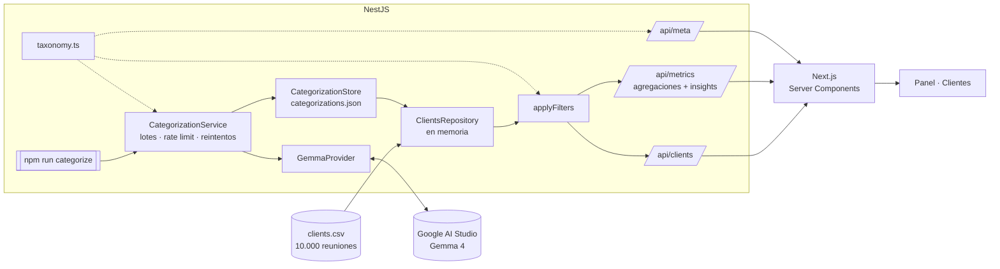

# Arquitectura y decisiones

## Visión general



El flujo se divide en dos momentos:

1. **Offline: categorización.** Un comando de consola recorre las transcripciones pendientes, las manda a Gemma en lotes, valida la respuesta y guarda el resultado en `categorizations.json`.
2. **Online: consulta.** La API carga el CSV y las categorizaciones en memoria, y responde listados y métricas filtradas en milisegundos. No llama al LLM en tiempo de consulta.

## Decisiones clave

### 1. La taxonomía es la fuente única de verdad

`backend/src/categorization/taxonomy.ts` define cada dimensión: sus valores, etiquetas, descripción y una pista para el LLM. A partir de ese archivo se generan:

- la sección del **prompt** que lista los valores permitidos,
- la **validación** de la respuesta del modelo,
- los **DTOs de filtros** (un valor fuera de la taxonomía responde 400),
- el endpoint `/api/meta`, del que el **frontend** toma filtros y etiquetas.

Agregar una categoría nueva es editar un solo archivo; no hay listas duplicadas que se desincronicen.

### 2. Categorías cerradas, no texto libre

El LLM debe elegir entre valores predefinidos en vez de inventar etiquetas. Así las categorías se pueden agregar y comparar: "Clínica dental" y "Consulta odontológica" caen ambas en `salud`. La única salida libre es `summary`, que es solo informativa.

### 3. Validación defensiva de la salida del LLM

Gemma no soporta *JSON mode* en esta API, así que `response-parser.ts`:

- extrae el JSON aunque venga dentro de bloques de código o con texto alrededor,
- normaliza tildes, mayúsculas y espacios (`"Servicios Profesionales"` → `servicios_profesionales`),
- descarta valores fuera de la taxonomía en listas y usa `otro` o un valor neutro en dimensiones simples,
- convierte números en formato chileno (`"1.500"` → 1500),
- descarta solo los elementos inválidos, no el lote completo; los que faltan se reintentan uno por uno.

### 4. Pipeline de categorización robusto y barato

- **Lotes de 10 transcripciones por request**, emparejadas por `ref`: 10 veces menos llamadas que de a una.
- **Thinking mínimo**: la extracción no requiere razonamiento largo. Bajó la latencia de ~60 s a ~4 s por transcripción.
- **Rate limiter compartido** entre los workers concurrentes. Ante un 429 se pausan todos según el `retryDelay` que indica la API.
- **Reintentos con backoff** ante 503/504 (frecuentes en el free tier), alternando con un **modelo de respaldo**.
- **Reanudable e idempotente**: solo procesa clientes sin categorizar y persiste después de cada lote con escritura atómica (archivo temporal + rename).
- **Muestra aleatoria reproducible** (`--seed`): se categorizan 1.000 clientes elegidos al azar en vez de las primeras 1.000 filas, para que el segmento represente todo el período, vendedores y rubros.
- Se guarda el **modelo que respondió** en cada registro, para trazabilidad.

### 5. Iteración del prompt guiada por los datos

En una primera corrida, revisando valores extremos, vi que el modelo **inventaba volúmenes** cuando la transcripción decía "miles de consultas", o los derivaba de "2.000 entregas mensuales". Eso inflaba el KPI de consultas automatizadas. Agregué reglas explícitas (usar solo cifras explícitas de consultas; si no hay, `null`) y criterios observables para la urgencia, y volví a correr la muestra completa con el prompt corregido.

En una segunda revisión encontré que el modelo **extrapolaba cifras de picos** como si fueran el volumen normal ("120 consultas por hora en el peak" → 345.600/mes; "3.000 mensajes diarios en Black Friday" → 90.000/mes). Agregué la regla de usar solo el volumen normal (si solo hay cifra de pico, `null`) y recategoricé únicamente los 86 clientes cuya transcripción menciona picos, temporadas, campañas o cifras por hora (`npm run categorize -- --ids ...`). El volumen cambió en 29 de ellos, el máximo bajó a 150.000/mes (un "5.000 consultas diarias" legítimo) y el KPI de consultas automatizadas bajó de 2,8 M a 2,06 M.

Efecto colateral observado: al recategorizar, ~19% de las dimensiones simples de esos 86 clientes cambiaron de valor, aunque la temperatura es baja (0,1). Es una medida útil de la estabilidad del modelo: en casos ambiguos (p. ej. urgencia media vs. alta) su respuesta no es determinista.

### 6. Datos en memoria + JSON versionado, sin base de datos

Con 10.000 filas, filtrar y agregar en memoria toma pocos milisegundos. Una base de datos agregaría infraestructura sin beneficio a esta escala. El acceso a datos está aislado en `ClientsRepository` y `CategorizationStore`, así que migrar a Postgres o SQLite solo implica reimplementar esas dos clases.

El resultado de la categorización se versiona en el repo: categorizar tiene costo y es lento, así que se hace una vez y la app desplegada no depende del LLM ni de su cuota.

### 7. Filtros compartidos y en la URL

Las métricas y la tabla usan **el mismo `ClientFilterDto` y la misma función `applyFilters`**, así que siempre muestran exactamente el mismo segmento. En el frontend los filtros viven en la URL: una vista filtrada se puede compartir, guardar o recorrer con "atrás". Las páginas son Server Components que leen los `searchParams`; los controles son componentes cliente que actualizan la URL dentro de una transición, sin bloquear la UI.

Semántica: OR dentro de una dimensión (salud **o** educación), AND entre dimensiones (salud **y** referido).

## Dimensiones extraídas

| Dimensión | Tipo | Para qué sirve |
| --- | --- | --- |
| **Industria** | simple | Segmentar el mercado, detectar rubros que convierten más y menos |
| **Tamaño** | simple | Diferenciar pricing y estrategia entre pymes y cuentas grandes |
| **Canal de adquisición** | simple | Medir el retorno de cada canal de marketing (referidos, eventos, LinkedIn…) |
| **Canal de consultas** | simple | Saber qué canales debe cubrir el producto (WhatsApp, teléfono…) |
| **Dolor principal** | simple | Ajustar el pitch al problema de fondo del cliente |
| **Casos de uso** | múltiple | Qué funciones se piden (agendamiento, cotizaciones, FAQ…) |
| **Integraciones** | múltiple | Priorizar el roadmap de conectores (CRM, ERP, agenda, POS…) |
| **Requisitos clave** | múltiple | Capacidades exigidas: 24/7, multiidioma, derivación a humano, datos sensibles |
| **Objeciones** | múltiple | Frenos explícitos en la reunión (precio, comparando alternativas…) |
| **Urgencia** | simple | Priorizar el seguimiento de leads |
| **Complejidad técnica** | simple | Estimar el esfuerzo de onboarding e implementación |
| **Consultas / mes** | número | Volumen normalizado (diarias × 30, semanales × 4) para dimensionar el valor |
| **Resumen** | texto | Lectura rápida de la necesidad en la tabla |

## Métricas del panel

El panel se diseñó para leerse de arriba hacia abajo en pocos segundos: primero la respuesta rápida, después el detalle y al final el contexto. La exploración detallada (búsqueda y todas las dimensiones como filtro) vive en la vista *Clientes*.

1. **Tres cifras clave**: reuniones, tasa de cierre y consultas mensuales automatizadas en los clientes cerrados (el valor que entrega Vambe).
2. **Lo más importante**: los 2 grupos de clientes que más suben la tasa de cierre y los 2 que más la bajan. Solo se consideran grupos con al menos 3% de la muestra y se excluyen valores comodín como "Otro". Cada hallazgo filtra el panel al hacer clic.
3. **¿Qué clientes cierran más?**: tasa de cierre por industria, canal de adquisición, tamaño o dolor principal, frente al promedio. Los grupos muy chicos se atenúan.
4. **¿Qué piden los clientes?**: los 6 casos de uso o integraciones más mencionados.
5. **Reuniones por mes** y **¿Cómo le va a cada vendedor?** como contexto. Los vendedores se comparan **ajustados por cartera**: para cada uno se calcula cuánto se esperaba que cerrara si hubiera cerrado como el promedio del equipo en cada uno de sus rubros (estandarización directa), y se ordena por la diferencia entre lo real y lo esperado. Así un vendedor con rubros difíciles no queda último por la asignación que le tocó.

**Muestras chicas:** en los desgloses, los grupos con menos de 10 reuniones (o 2% de las analizadas) no compiten en el ranking: van plegados al final, porque "3 de 3" no es un 100% confiable. Al pasar el mouse por cualquier fila se ve su rango probable (intervalo de Wilson al 95%).

La visualización sigue una paleta validada para daltonismo: azul = sobre el promedio, rojo = bajo el promedio, y el color siempre va acompañado de la cifra (diferencia en puntos y cantidad de reuniones).

## Oportunidades: de las métricas a la acción

El panel describe; esta vista propone qué hacer. Un clic en un grupo abre un panel lateral con sus cifras, la acción sugerida y enlaces explícitos ("Ver este grupo en el panel" / "Ver sus N clientes"); al llegar al destino, un banner fijo muestra el filtro aplicado y permite volver. Cada bloque es una función pura en `backend/src/opportunities/` con su test, y responde una pregunta del equipo:

| Bloque | Pregunta | Cómo se calcula |
| --- | --- | --- |
| **Mapa de segmentos** | ¿Dónde pongo el esfuerzo? | Cada rubro, canal y tamaño se clasifica por volumen (sobre o bajo la mediana de su dimensión) y conversión (±3 puntos del promedio; lo que queda dentro es ruido y se omite). Resultado: *proteger*, *invertir para captar más*, *mejorar el pitch* o *despriorizar*. |
| **Leads recuperables** | ¿A quién vuelvo a llamar? | A cada lead perdido se le estima una probabilidad de cierre como el promedio de las tasas de los grupos a los que pertenece (rubro, canal, tamaño, dolor, urgencia). Modelo simple y explicable: cada razón se muestra. Se proponen los que tienen perfil sobre el promedio, empezando por los de más consultas al mes (más valor para Vambe). |
| **Asignación sugerida** | ¿Qué vendedor toma cada lead? | Para cada rubro frecuente, el vendedor que más cierra frente al equipo (al menos +5 puntos y 8 reuniones). |
| **Frenos a resolver** | ¿Qué baja las ventas? | Requisitos, objeciones, integraciones y casos de uso que cierran bajo el promedio, ordenados por impacto (puntos perdidos × reuniones). Cada uno trae una acción de un *playbook* (`playbook.ts`) que el equipo comercial puede editar sin tocar la lógica. |
| **Soluciones replicables** | ¿Qué construyo una vez y vendo en muchos rubros? | Pares de casos de uso (sin contar FAQ, que piden casi todos) presentes en 4 o más industrias distintas. Son candidatos a plantillas verticales. |

## Predicción de cierre (regresión logística)

`backend/src/prediction/` estima la probabilidad de que cada cliente compre a partir de lo que extrajo el LLM.

- **Variables:** una variable 0/1 por cada valor de cada dimensión (rubro, canal, tamaño, dolor, urgencia, complejidad, canal de consultas, casos de uso, integraciones, requisitos, objeciones), más el volumen de consultas en escala logarítmica.
- **Modelo:** regresión logística con regularización L2, implementada sin dependencias (`logistic-regression.ts`). La regularización se aplica como paso proximal, que es numéricamente estable.
- **Validación cruzada de 5 partes:** cada cliente recibe la probabilidad de un modelo que no lo vio al entrenar, así que las métricas no están infladas.
- **Elección de la regularización:** probé l2 entre 1 y 400. Con l2 = 30 el log loss es mínimo (0,618 vs. 0,629 de no usar modelo). Con menos regularización sobreajusta y predice extremos que la realidad no respalda.
- **Resultado honesto:** AUC de 0,59. Hay señal real pero débil: lo que el cliente cuenta explica solo parte de si compra. Sirve para priorizar, no para asegurar cierres, y así se comunica en la UI.
- **Notas A–D:** cada cliente recibe una nota según su probabilidad (A ≥ 75%, B 70–75%, C 62–70%, D < 62%), definida en `prediction/grades.ts` con una acción sugerida por nota. Los cortes se eligieron sobre la distribución real para que la tasa de cierre baje de forma consistente: A cierra 76%, B 74%, C 65% y D 60%. Las notas se pueden filtrar y ordenar en *Clientes* (`?grade=A&sortBy=probability`).
- **Uso:** la pestaña *Predicción* muestra la calidad, la tabla de notas, la distribución de cerrados vs. no cerrados por probabilidad, la calibración y los factores (razones de chances). *Oportunidades* usa estas probabilidades para elegir los leads a recuperar, y explica cada uno con las variables que más suben su probabilidad.

## Medición de precisión

`npm run evaluate` compara las categorías del LLM con un *gold standard* etiquetado a mano (`data/evaluation/gold.json`): acierto exacto por dimensión, solapamiento (Jaccard) en dimensiones de lista y volumen de consultas dentro de ±20%. Solo cuentan los casos marcados como revisados por una persona.

## Estructura del código

### Backend (`backend/src`)

Cada módulo de Nest sigue la misma forma: `*.controller.ts` (HTTP, sin lógica) → `*.service.ts` (coordina) → funciones puras en archivos propios (fáciles de testear). Los contratos de respuesta están en `*.types.ts` y los de entrada en DTOs validados con `class-validator`.

```
backend/src
├── main.ts / app.module.ts / app.setup.ts   arranque y configuración HTTP compartida
├── config/env.ts                 variables de entorno validadas con Zod (falla al arrancar si son inválidas)
├── domain/                       modelo de negocio, sin dependencias de Nest
│   ├── taxonomy.ts               dimensiones y valores permitidos (fuente única de verdad)
│   └── client.ts                 RawClient, Client, CategorizationRecord
├── common/                       utilidades genéricas: texto, colecciones, async
├── data/                         persistencia
│   ├── csv-loader.ts             CSV → RawClient[]
│   ├── clients.repository.ts     clientes en memoria + índice de búsqueda
│   └── categorization.store.ts   categorizaciones en JSON (escritura atómica)
├── filters/                      segmento de clientes compartido por tabla y métricas
│   ├── client-filter.dto.ts      query params validados contra la taxonomía
│   ├── query-transforms.ts       "a,b" → ['a','b'], "true" → true
│   ├── apply-filters.ts          lógica de filtrado (pura)
│   └── client-filter.service.ts  punto único para obtener el segmento
├── clients/                      GET /api/clients[/:id]
│   ├── dto/clients-query.dto.ts  filtros + paginación + orden
│   ├── clients.sorting.ts        orden (puro)
│   ├── clients.mapper.ts         Client → ClientListItem
│   └── clients.types.ts          contratos de respuesta
├── metrics/                      GET /api/metrics
│   ├── kpis.ts / aggregations.ts / insights.ts   cálculos (puros)
│   └── metrics.types.ts          contrato de respuesta
├── opportunities/                GET /api/opportunities: una función pura por bloque + playbook.ts
├── prediction/                   GET /api/prediction: regresión logística, validación cruzada, métricas
├── meta/                         GET /api/meta (taxonomía y opciones de filtro)
├── health/                       GET /api/health
├── categorization/               pipeline LLM
│   ├── categorization.service.ts orquesta la corrida: muestra, cola, workers, reintentos
│   ├── batch-categorizer.ts      un lote: prompt → LLM → parseo → registros
│   ├── llm/                      LlmProvider (interfaz), GemmaProvider, RateLimitedLlmProvider (decorator), factory
│   ├── prompt/                   construcción del prompt desde la taxonomía
│   ├── parsing/                  validación y normalización de la respuesta del modelo
│   ├── evaluation/               comparación contra etiquetas humanas
│   └── utils/                    rate limiter, muestreo reproducible
└── cli/                          comandos `npm run categorize` y `npm run evaluate`
```

### Frontend (`frontend/src`)

Las páginas son Server Components que leen los filtros de la URL, llaman a la API y pasan datos ya validados a los componentes. Solo los componentes interactivos llevan `'use client'`.

```
frontend/src
├── app/                          páginas: panel (/), oportunidades, predicción y clientes
├── lib/
│   ├── api/
│   │   ├── schemas.ts            esquemas Zod de cada respuesta (contrato con el backend)
│   │   ├── types.ts              tipos derivados de los esquemas (z.infer)
│   │   ├── http.ts               fetch + validación + ApiError
│   │   └── index.ts              cliente tipado: api.meta(), api.metrics(), …
│   ├── filters/                  filtros ↔ URL (params.ts), chips de filtros activos, hrefs
│   ├── format.ts / labels.ts / metrics.ts   formato es-CL, etiquetas de la taxonomía, umbrales
└── components/
    ├── filters/                  FilterBar compuesta de SearchInput, ClosedFilter, MultiSelect,
    │                             DateRangeFilter, ActiveFilterChips + hook useFilterParams
    ├── dashboard/                KPIs, hallazgos, gráficos y desgloses
    ├── opportunities/            mapa de segmentos, leads recuperables, asignación, frenos, soluciones
    ├── prediction/               calidad del modelo, distribución, calibración y factores
    ├── clients/                  tabla (ClientRow, SortableHeader), Pagination, ClientDrawer
    └── ui/                       Card, Badge, Tabs, Sidebar, PageHeader
```

### Validación de tipos en ambos lados

| Dónde | Qué se valida | Con qué |
| --- | --- | --- |
| Backend, entrada | Query params (filtros, paginación, orden); valores fuera de la taxonomía → 400 | `class-validator` + `ValidationPipe` |
| Backend, configuración | Variables de entorno al arrancar | Zod |
| Backend, LLM | Respuesta del modelo (JSON, valores permitidos, números) | `response-parser.ts` |
| Backend, salida | Cada endpoint declara su tipo de respuesta | interfaces `*.types.ts` |
| Frontend, entrada | Cada respuesta de la API se valida al llegar | Zod (`lib/api/schemas.ts`) |

Los tipos del frontend se derivan de sus esquemas Zod, no de una copia manual, así que si el backend cambia un contrato el error aparece en el punto de entrada. Una alternativa sería un paquete compartido de tipos en un monorepo con workspaces; se descartó para no complicar el build y el despliegue por separado de Vercel y Render.

## Limitaciones y próximos pasos

- **Cobertura**: se categorizó una muestra de 1.000 de 10.000 reuniones (10%) por la cuota del free tier. El pipeline soporta procesar el resto con `npm run categorize -- --limit 9000`.
- **Evaluación de calidad**: la herramienta `npm run evaluate` está lista y la plantilla de 50 casos generada; falta etiquetarlos a mano para tener el número de precisión.
- **Categorización online**: un endpoint o cola (BullMQ) para categorizar reuniones nuevas a medida que llegan.
- **Persistencia**: migrar a Postgres si el volumen crece o si se necesita escritura concurrente.
