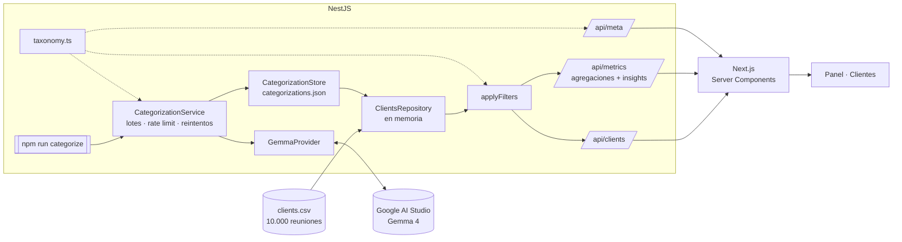

# Arquitectura y decisiones

## Visión general



El flujo se divide en dos momentos:

1. **Offline: categorización.** Un comando de consola recorre las transcripciones pendientes, las manda a Gemma en lotes, valida la respuesta y guarda el resultado en `categorizations.json`.
2. **Online: consulta.** La API carga el CSV y las categorizaciones en memoria, y responde listados y métricas filtradas en milisegundos. No llama al LLM en tiempo de consulta.

## Decisiones clave

### 1. La taxonomía es la fuente única de verdad

`backend/src/categorization/taxonomy.ts` define cada dimensión: sus valores, etiquetas, descripción y una pista para el LLM. A partir de ese archivo se generan:

- la sección del **prompt** que lista los valores permitidos,
- la **validación** de la respuesta del modelo,
- los **DTOs de filtros** (un valor fuera de la taxonomía responde 400),
- el endpoint `/api/meta`, del que el **frontend** toma filtros y etiquetas.

Agregar una categoría nueva es editar un solo archivo; no hay listas duplicadas que se desincronicen.

### 2. Categorías cerradas, no texto libre

El LLM debe elegir entre valores predefinidos en vez de inventar etiquetas. Así las categorías se pueden agregar y comparar: "Clínica dental" y "Consulta odontológica" caen ambas en `salud`. La única salida libre es `summary`, que es solo informativa.

### 3. Validación defensiva de la salida del LLM

Gemma no soporta *JSON mode* en esta API, así que `response-parser.ts`:

- extrae el JSON aunque venga dentro de bloques de código o con texto alrededor,
- normaliza tildes, mayúsculas y espacios (`"Servicios Profesionales"` → `servicios_profesionales`),
- descarta valores fuera de la taxonomía en listas y usa `otro` o un valor neutro en dimensiones simples,
- convierte números en formato chileno (`"1.500"` → 1500),
- descarta solo los elementos inválidos, no el lote completo; los que faltan se reintentan uno por uno.

### 4. Pipeline de categorización robusto y barato

- **Lotes de 10 transcripciones por request**, emparejadas por `ref`: 10 veces menos llamadas que de a una.
- **Thinking mínimo**: la extracción no requiere razonamiento largo. Bajó la latencia de ~60 s a ~4 s por transcripción.
- **Rate limiter compartido** entre los workers concurrentes. Ante un 429 se pausan todos según el `retryDelay` que indica la API.
- **Reintentos con backoff** ante 503/504 (frecuentes en el free tier), alternando con un **modelo de respaldo**.
- **Reanudable e idempotente**: solo procesa clientes sin categorizar y persiste después de cada lote con escritura atómica (archivo temporal + rename).
- **Muestra aleatoria reproducible** (`--seed`): se categorizan 1.000 clientes elegidos al azar en vez de las primeras 1.000 filas, para que el segmento represente todo el período, vendedores y rubros.
- Se guarda el **modelo que respondió** en cada registro, para trazabilidad.

### 5. Iteración del prompt guiada por los datos

En una primera corrida, revisando valores extremos, vi que el modelo **inventaba volúmenes** cuando la transcripción decía "miles de consultas", o los derivaba de "2.000 entregas mensuales". Eso inflaba el KPI de consultas automatizadas. Agregué reglas explícitas (usar solo cifras explícitas de consultas; si no hay, `null`) y criterios observables para la urgencia, y volví a correr la muestra completa con el prompt corregido.

### 6. Datos en memoria + JSON versionado, sin base de datos

Con 10.000 filas, filtrar y agregar en memoria toma pocos milisegundos. Una base de datos agregaría infraestructura sin beneficio a esta escala. El acceso a datos está aislado en `ClientsRepository` y `CategorizationStore`, así que migrar a Postgres o SQLite solo implica reimplementar esas dos clases.

El resultado de la categorización se versiona en el repo: categorizar tiene costo y es lento, así que se hace una vez y la app desplegada no depende del LLM ni de su cuota.

### 7. Filtros compartidos y en la URL

Las métricas y la tabla usan **el mismo `ClientFilterDto` y la misma función `applyFilters`**, así que siempre muestran exactamente el mismo segmento. En el frontend los filtros viven en la URL: una vista filtrada se puede compartir, guardar o recorrer con "atrás". Las páginas son Server Components que leen los `searchParams`; los controles son componentes cliente que actualizan la URL dentro de una transición, sin bloquear la UI.

Semántica: OR dentro de una dimensión (salud **o** educación), AND entre dimensiones (salud **y** referido).

## Dimensiones extraídas

| Dimensión | Tipo | Para qué sirve |
| --- | --- | --- |
| **Industria** | simple | Segmentar el mercado, detectar rubros que convierten más y menos |
| **Tamaño** | simple | Diferenciar pricing y estrategia entre pymes y cuentas grandes |
| **Canal de adquisición** | simple | Medir el retorno de cada canal de marketing (referidos, eventos, LinkedIn…) |
| **Canal de consultas** | simple | Saber qué canales debe cubrir el producto (WhatsApp, teléfono…) |
| **Dolor principal** | simple | Ajustar el pitch al problema de fondo del cliente |
| **Casos de uso** | múltiple | Qué funciones se piden (agendamiento, cotizaciones, FAQ…) |
| **Integraciones** | múltiple | Priorizar el roadmap de conectores (CRM, ERP, agenda, POS…) |
| **Requisitos clave** | múltiple | Capacidades exigidas: 24/7, multiidioma, derivación a humano, datos sensibles |
| **Objeciones** | múltiple | Frenos explícitos en la reunión (precio, comparando alternativas…) |
| **Urgencia** | simple | Priorizar el seguimiento de leads |
| **Complejidad técnica** | simple | Estimar el esfuerzo de onboarding e implementación |
| **Consultas / mes** | número | Volumen normalizado (diarias × 30, semanales × 4) para dimensionar el valor |
| **Resumen** | texto | Lectura rápida de la necesidad en la tabla |

## Métricas del panel

- **KPIs**: reuniones, tasa de cierre, consultas mensuales automatizadas en clientes cerrados (el valor entregado por Vambe) y cobertura de la IA.
- **Hallazgos automáticos**: segmentos cuya tasa de cierre se desvía del promedio, solo con muestras ≥ 3% del total y sin valores comodín como "Otro". Incluyen vendedores "especialistas" por rubro. Cada hallazgo es clicable y filtra el panel.
- **Evolución mensual**: volumen y tasa de cierre en vistas separadas, sin doble eje.
- **Desempeño por vendedor**: tasa de cierre frente al promedio.
- **Explorador de segmentos**: cada dimensión vista como *tasa de cierre* (frente al promedio, con muestras chicas atenuadas) o como *demanda* (% de clientes).
- **Matriz vendedor × industria**: heatmap para asignar cada lead entrante al vendedor con mejor historial en su rubro.
- **Señales de producto**: casos de uso, integraciones y requisitos, ordenados por demanda o por impacto en el cierre.

La visualización sigue una paleta validada para daltonismo: azul = sobre el promedio, rojo = bajo el promedio, y siempre con texto (pp de diferencia y n) que acompaña al color.

## Estructura

```
backend/src
├── categorization/   taxonomía, prompt, parser, proveedor LLM, servicio de lotes
├── data/             CSV loader, repositorio en memoria, store de categorizaciones
├── filters/          DTO de filtros + applyFilters (compartidos)
├── clients/          /api/clients
├── metrics/          /api/metrics: agregaciones puras + generador de insights
├── meta/             /api/meta
├── config/           validación de variables de entorno (Zod)
└── cli/              comando de categorización
frontend/src
├── app/              páginas (Server Components): panel y clientes
├── components/       dashboard/, clients/, filters/, ui/
└── lib/              cliente de la API, tipos, filtros↔URL, formato
```

## Limitaciones y próximos pasos

- **Cobertura**: se categorizó una muestra de 1.000 de 10.000 reuniones (10%) por la cuota del free tier. El pipeline soporta procesar el resto con `npm run categorize -- --limit 9000`.
- **Evaluación de calidad**: hoy la validación es estructural más una revisión manual de muestras. El siguiente paso sería un set etiquetado a mano (~100 casos) para medir precisión por dimensión y comparar prompts y modelos.
- **Categorización online**: un endpoint o cola (BullMQ) para categorizar reuniones nuevas a medida que llegan.
- **Persistencia**: migrar a Postgres si el volumen crece o si se necesita escritura concurrente.
