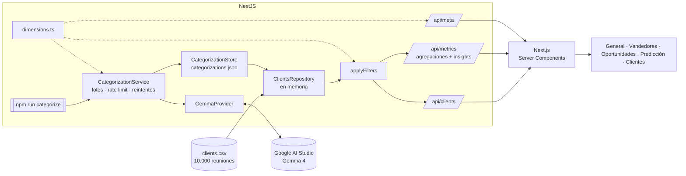

# Arquitectura y decisiones

## Visión general



El flujo se divide en dos momentos:

1. **Offline: categorización.** Un comando de consola recorre las transcripciones pendientes, las manda a Gemma en lotes, valida la respuesta y guarda el resultado en `categorizations.json`.
2. **Online: consulta.** La API carga el CSV y las categorizaciones en memoria, y responde listados y métricas filtradas en milisegundos. No llama al LLM en tiempo de consulta.

## Decisiones clave

### 1. La taxonomía es la fuente única de verdad

`backend/src/domain/dimensions.ts` define cada dimensión: sus valores, etiquetas, descripción, una pista para el LLM y los criterios para elegir cada valor. A partir de ese archivo se generan:

- la sección del **prompt** que lista los valores permitidos,
- la **validación** de la respuesta del modelo,
- los **DTOs de filtros** (un valor fuera de la taxonomía responde 400),
- el endpoint `/api/meta`, del que el **frontend** toma filtros y etiquetas.

Agregar una categoría nueva es editar un solo archivo; no hay listas duplicadas que se desincronicen.

### 2. Categorías cerradas, no texto libre

El LLM debe elegir entre valores predefinidos en vez de inventar etiquetas. Así las categorías se pueden agregar y comparar: "Clínica dental" y "Consulta odontológica" caen ambas en `salud`. La única salida libre es `summary`, que es solo informativa.

### 3. Validación defensiva de la salida del LLM

Gemma no soporta *JSON mode* en esta API, así que `response-parser.ts`:

- extrae el JSON aunque venga dentro de bloques de código o con texto alrededor,
- normaliza tildes, mayúsculas y espacios (`"Servicios Profesionales"` → `servicios_profesionales`),
- descarta valores fuera de la taxonomía en listas y usa `otro` o un valor neutro en dimensiones simples,
- convierte números en formato chileno (`"1.500"` → 1500),
- descarta solo los elementos inválidos, no el lote completo; los que faltan se reintentan uno por uno.

### 4. Pipeline de categorización robusto y barato

- **Lotes de 10 transcripciones por request**, emparejadas por `ref`: 10 veces menos llamadas que de a una.
- **Thinking mínimo**: la extracción no requiere razonamiento largo. Bajó la latencia de ~60 s a ~4 s por transcripción.
- **Rate limiter compartido** entre los workers concurrentes. Ante un 429 se pausan todos según el `retryDelay` que indica la API.
- **Reintentos con backoff** ante 503/504 (frecuentes en el free tier), alternando con un **modelo de respaldo**.
- **Reanudable e idempotente**: solo procesa clientes sin categorizar y persiste después de cada lote con escritura atómica (archivo temporal + rename).
- **Orden del CSV:** los pendientes se procesan en el orden del archivo y los ya categorizados se saltan. Como el despliegue usa las 10.000 reuniones categorizadas, el orden no afecta los resultados; con una corrida a medias, las estimaciones que escalan lo analizado al total (consultas automatizadas) serían aproximadas.
- Se guarda el **modelo que respondió** en cada registro, para trazabilidad.

### 5. Iteración del prompt guiada por los datos

En una primera corrida, revisando valores extremos, vi que el modelo **inventaba volúmenes** cuando la transcripción decía "miles de consultas", o los derivaba de "2.000 entregas mensuales". Eso inflaba el KPI de consultas automatizadas. Agregué reglas explícitas (usar solo cifras explícitas de consultas; si no hay, `null`) y criterios observables para la urgencia, y volví a correr la muestra completa con el prompt corregido.

En una segunda revisión encontré que el modelo **extrapolaba cifras de picos** como si fueran el volumen normal ("120 consultas por hora en el peak" → 345.600/mes; "3.000 mensajes diarios en Black Friday" → 90.000/mes). Agregué la regla de usar solo el volumen normal (si solo hay cifra de pico, `null`) y recategoricé únicamente los 86 clientes cuya transcripción menciona picos, temporadas, campañas o cifras por hora (`npm run categorize -- --ids ...`). El volumen cambió en 29 de ellos, el máximo bajó a 150.000/mes (un "5.000 consultas diarias" legítimo) y el KPI de consultas automatizadas bajó de 2,8 M a 2,06 M.

Efecto colateral observado: al recategorizar, ~19% de las dimensiones simples de esos 86 clientes cambiaron de valor, aunque la temperatura es baja (0,1). Es una medida útil de la estabilidad del modelo: en casos ambiguos (p. ej. urgencia media vs. alta) su respuesta no es determinista.

En una tercera iteración, guiada por los evals, reemplacé las descripciones de una línea por **criterios explícitos por valor** (`criteria` en `domain/dimensions.ts`), escritos como reglas observables y con orden de prioridad cuando varias aplican. Por ejemplo, para el tamaño: primero la cantidad de locales, después la de empleados y después cómo se describe el negocio; sin pistas, `no_especificado`, sin deducirlo del rubro ni del volumen. Los mismos criterios sirven para etiquetar el gold, así que el modelo y quien etiqueta aplican la misma definición. Las reglas fijas dejaron de pedírsele al LLM y se calculan en código: la **complejidad** (a partir de integraciones, requisitos y casos de uso, en `domain/derived-rules.ts`) y el dolor **volumen alto** cuando hay más de 5.000 consultas al mes (mismo archivo). Además de subir la precisión, las respuestas se volvieron más estables: en varias corridas seguidas el modelo dio exactamente lo mismo.

### 6. Datos en memoria + JSON versionado, sin base de datos

Con 10.000 filas, filtrar y agregar en memoria toma pocos milisegundos. Una base de datos agregaría infraestructura sin beneficio a esta escala. El acceso a datos está aislado en `ClientsRepository` y `CategorizationStore`, así que migrar a Postgres o SQLite solo implica reimplementar esas dos clases.

El resultado de la categorización se versiona en el repo: categorizar tiene costo y es lento, así que se hace una vez y la app desplegada no depende del LLM ni de su cuota.

### 7. Filtros compartidos y en la URL

Las métricas y la tabla usan **el mismo `ClientFilterDto` y la misma función `applyFilters`**, así que siempre muestran exactamente el mismo segmento. En el frontend los filtros viven en la URL: una vista filtrada se puede compartir, guardar o recorrer con "atrás". Las páginas son Server Components que leen los `searchParams`; los controles son componentes cliente que actualizan la URL dentro de una transición, sin bloquear la UI.

Semántica: OR dentro de una dimensión (salud **o** educación), AND entre dimensiones (salud **y** referido).

## Dimensiones extraídas

| Dimensión | Tipo | Para qué sirve |
| --- | --- | --- |
| **Industria** | simple | Segmentar el mercado, detectar rubros que convierten más y menos |
| **Tamaño** | simple | Diferenciar pricing y estrategia entre pymes y cuentas grandes |
| **Canal de adquisición** | simple | Medir el retorno de cada canal de marketing (referidos, eventos, LinkedIn…) |
| **Canal de consultas** | simple | Saber qué canales debe cubrir el producto (WhatsApp, teléfono…) |
| **Dolor principal** | simple | Ajustar el pitch al problema de fondo del cliente |
| **Casos de uso** | múltiple | Qué funciones se piden (agendamiento, cotizaciones, FAQ…) |
| **Integraciones** | múltiple | Priorizar el roadmap de conectores (CRM, ERP, agenda, POS…) |
| **Requisitos clave** | múltiple | Capacidades exigidas: 24/7, multiidioma, derivación a humano, datos sensibles |
| **Objeciones** | múltiple | Frenos explícitos en la reunión (precio, comparando alternativas…) |
| **Urgencia** | simple | Priorizar el seguimiento de leads |
| **Complejidad técnica** | simple (calculada) | Estimar el esfuerzo de implementación. No la responde el LLM: alta = 2+ integraciones, varios idiomas o datos sensibles; media = 1 integración o algún flujo transaccional; baja = solo informar |
| **Consultas / mes** | número | Volumen normalizado (diarias × 30, semanales × 4) para dimensionar el valor |
| **Resumen** | texto | Lectura rápida de la necesidad en la tabla |

## Métricas del panel

El panel se diseñó para leerse de arriba hacia abajo en pocos segundos: primero la respuesta rápida, después el detalle y al final el contexto. La exploración detallada (búsqueda y todas las dimensiones como filtro) vive en la vista *Clientes*.

1. **Tres cifras clave**: reuniones, tasa de cierre y consultas mensuales automatizadas en los clientes cerrados (el valor que entrega Vambe).
2. **Lo más importante**: los 2 grupos de clientes que más suben la tasa de cierre y los 2 que más la bajan. Solo se consideran grupos con al menos 3% de la muestra y se excluyen valores comodín como "Otro". Cada hallazgo filtra el panel al hacer clic.
3. **¿Qué clientes cierran más?**: tasa de cierre por industria, canal de adquisición, tamaño o dolor principal, frente al promedio. Los grupos muy chicos se atenúan.
4. **¿Qué piden los clientes?**: los 6 casos de uso o integraciones más mencionados.
5. **Reuniones por mes** y **¿Cómo le va a cada vendedor?** como contexto. Los vendedores se comparan **ajustados por cartera**: para cada uno se calcula cuánto se esperaba que cerrara si hubiera cerrado como el promedio del equipo en cada uno de sus rubros (estandarización directa), y se ordena por la diferencia entre lo real y lo esperado. Así un vendedor con rubros difíciles no queda último por la asignación que le tocó.

**Muestras chicas:** en los desgloses, los grupos con menos de 10 reuniones (o 2% de las analizadas) no compiten en el ranking: van plegados al final, porque "3 de 3" no es un 100% confiable. Al pasar el mouse por cualquier fila se ve su rango probable (intervalo de Wilson al 95%).

La visualización sigue una paleta validada para daltonismo: azul = sobre el promedio, rojo = bajo el promedio, y el color siempre va acompañado de la cifra (diferencia en puntos y cantidad de reuniones).

## Oportunidades: de las métricas a la acción

El panel describe; esta vista propone qué hacer. Un clic en un grupo abre un panel lateral con sus cifras, la acción sugerida y enlaces explícitos ("Ver este grupo en el panel" / "Ver sus N clientes"); al llegar al destino, un banner fijo muestra el filtro aplicado y permite volver. Cada bloque es una función pura en `backend/src/opportunities/` con su test, y responde una pregunta del equipo:

| Bloque | Pregunta | Cómo se calcula |
| --- | --- | --- |
| **Mapa de segmentos** | ¿Dónde pongo el esfuerzo? | Cada rubro, canal y tamaño se clasifica por volumen (sobre o bajo la mediana de su dimensión) y conversión (±3 puntos del promedio; lo que queda dentro es ruido y se omite). Cada cuadrante se nombra por su regla (p. ej. «Muchas reuniones · cierran bajo el promedio»), sin recomendaciones escritas a mano. |
| **Leads recuperables** | ¿A quién vuelvo a llamar? | Leads perdidos a los que la regresión logística (ver Predicción) les da una probabilidad de cierre sobre el promedio, empezando por los de más consultas al mes (más valor para Vambe). Cada uno muestra las dos variables que más le suben la probabilidad. |
| **Top vendedores por industria** | ¿Qué vendedor cierra mejor cada rubro? | Para cada rubro frecuente, el vendedor que más cierra frente al equipo (al menos +5 puntos y 8 reuniones). |
| **Frenos a resolver** | ¿Qué baja las ventas? | Requisitos, objeciones, integraciones y casos de uso que cierran bajo el promedio, ordenados por impacto (puntos perdidos × reuniones). Cada uno trae sus **rasgos ganadores** (`analytics/winning-traits.ts`): dentro del grupo con ese freno, los rasgos con los que sí se cerró (al menos +5 pts sobre el grupo, con 10+ reuniones y el 10% del grupo). Ningún consejo está escrito a mano: todo sale de los datos. |
| **Soluciones replicables** | ¿Qué construyo una vez y vendo en muchos rubros? | Pares de casos de uso (sin contar FAQ, que piden casi todos) presentes en 4 o más industrias distintas. Son candidatos a plantillas verticales. |

## Vendedores

`backend/src/sellers/` (`GET /api/sellers`) muestra cómo le va a cada vendedor:

- **Tarjeta por vendedor:** tasa de cierre frente a la esperada según los rubros de sus leads (la misma estandarización directa del panel, en `analytics/seller-performance.ts`), y su rubro más fuerte y más flojo frente al equipo (solo rubros accionables con 8 o más reuniones suyas).
- **Tabla vendedor × industria:** tasa de cierre de cada vendedor en cada rubro y su diferencia con el equipo en ese mismo rubro. Se pintan las diferencias de 5 puntos o más; las celdas con menos de 8 reuniones van en gris. Cada celda lleva a esas reuniones en la tabla de clientes.

## Predicción de cierre (regresión logística)

`backend/src/prediction/` estima la probabilidad de que cada cliente compre a partir de lo que extrajo el LLM.

- **Variables:** una variable 0/1 por cada valor de cada dimensión (rubro, canal, tamaño, dolor, urgencia, complejidad, canal de consultas, casos de uso, integraciones, requisitos, objeciones), el **vendedor** y la combinación **vendedor × industria** (hay vendedores que cierran mucho mejor ciertos rubros; los vendedores salen de los datos), más el volumen de consultas en escala logarítmica.
- **Modelo:** regresión logística con regularización L2, implementada sin dependencias (`logistic-regression.ts`) y entrenada con el método de Newton (IRLS): converge al óptimo exacto en ~10 pasos y, recorriendo solo las variables distintas de 0 de cada fila, entrena 10.000 reuniones en menos de un segundo.
- **Cuándo se entrena:** en memoria, al arrancar el servidor (`main.ts`, antes de aceptar visitas) y de nuevo solo si cambian las categorizaciones. No llama al LLM: usa las categorías ya guardadas en `categorizations.json`.
- **Validación cruzada de 5 partes:** cada cliente recibe la probabilidad de un modelo que no lo vio al entrenar, así que las métricas no están infladas.
- **Elección de la regularización:** no hay un valor fijo. En cada entrenamiento se prueban l2 ∈ {3, 10, 30, 100} con la misma validación cruzada y se usa el de menor log loss. Con más datos suele ganar uno menor (con ~7.000 reuniones, l2 = 10).
- **Resultado:** la UI muestra el AUC y la mejora sobre no usar modelo calculados en cada entrenamiento (con ~7.000 reuniones, AUC ≈ 0,63). Agregar vendedor y vendedor × industria sumó ~0,01 de AUC; otras variables probadas (mes, señales del texto) no aportaron o no sirven para clientes nuevos.
- **Notas A–F:** cada cliente recibe una nota según su probabilidad (A ≥ 85%, B 80–85%, C 75–80%, D 70–75%, E 65–70%, F < 65%), definida en `domain/grades.ts`. Los cortes son fijos y no cuantiles a propósito: así la tabla muestra qué porcentaje de clientes cae en cada nota, cuánto cerró realmente y cuántos leads sin cerrar (y consultas al mes) quedan en ella. Las notas se pueden filtrar y ordenar en *Clientes* (`?grade=A&sortBy=probability`).
- **Uso:** la pestaña *Predicción* muestra la tabla de notas, la distribución de cerrados vs. no cerrados por probabilidad y los factores (razones de chances). *Oportunidades* usa estas probabilidades para elegir los leads a recuperar, y explica cada uno con las variables que más suben su probabilidad. Como el modelo conoce al vendedor, simula la probabilidad del lead con cada vendedor y sugiere el que más la sube (con los puntos que ganaría).

## Medición de precisión

`npm run evaluate` compara las categorías del LLM con un *gold standard* (`data/evaluation/gold.json`: casos con su categorización correcta): acierto exacto por dimensión, solapamiento (Jaccard) en dimensiones de lista y volumen de consultas dentro de ±20%. Solo cuentan los casos marcados como revisados.

Los criterios se ajustaron mirando 24 de los 50 casos; los otros 26 se etiquetaron después aplicando solo los criterios escritos y sirvieron como **prueba independiente**, para descartar reglas que solo funcionaran en los casos usados para escribirlas. 
### Resultados actuales

Promedio de 2 corridas a temperatura 0 con el prompt actual. Los criterios de cada dimensión (en `backend/src/domain/dimensions.ts`) se ajustaron mirando 24 casos; los otros 26 se etiquetaron después solo con esos criterios escritos y funcionan como **prueba independiente**: si las reglas solo sirvieran para los casos usados para escribirlas, ahí bajaría el acierto.

**Por caso: 96% de las dimensiones correctas en promedio**; 29 de los 50 casos salen perfectos en ambas corridas.

| Dimensión | Ajuste (24) | Prueba (26) | Total | Prompt anterior (24) |
| --- | --- | --- | --- | --- |
| Industria | 100% | 100% | 100% | 96% |
| Canal de adquisición | 100% | 100% | 100% | 88% |
| Complejidad técnica (calculada) | 100% | 100% | 100% | 63% |
| Estacionalidad | 100% | 100% | 100% | 100% |
| Objeciones | 100% | 100% | 100% | 100% |
| Integraciones | 96% | 100% | 98% | 71% |
| Tamaño | 98% | 96% | 97% | 46% |
| Canal de consultas | 96% | 98% | 97% | 94% |
| Dolor principal | 94% | 96% | 95% | 88% |
| Requisitos clave (solapamiento 97%) | 94% | 94% | 94% | 77% |
| Urgencia | 83% | 100% | 92% | 94% |
| **Casos de uso** (solapamiento 90%) | 79% | 77% | **78%** | 38% |
| Consultas/mes (±20%) | 100% | 92% | 96% | 100% |
| Consultas/mes en peak (±20%) | 100% | 100% | 100% | 100% |

La columna «Prompt anterior» mide el prompt previo contra las mismas etiquetas (solo los 24 casos de ajuste).

Qué cambió:

- **Criterios explícitos por valor**, con orden de prioridad cuando varias reglas aplican. Por ejemplo, el tamaño se decide primero por la cantidad de locales, después por la de empleados y después por cómo se describe el negocio; sin pistas queda «No especificado», en vez de adivinarlo por el rubro o el volumen. «Catálogo» quedó acotado a productos físicos, propiedades, espacios y tours (presentar servicios, programas o un portafolio es «Preguntas frecuentes»).
- **Reglas fijas calculadas en código** en vez de pedírselas al LLM, que las aplicaba de forma inconsistente: la complejidad (a partir de integraciones, requisitos y casos de uso) y el dolor «volumen alto» cuando hay más de 5.000 consultas al mes.
- **El gold se revisó con los mismos criterios.** Había etiquetas contradictorias entre casos parecidos (p. ej. «la conocí a través de un colega en LinkedIn» marcado como referido en un caso y como LinkedIn en otros). Los casos dudosos los decidió una persona.

Lo que falta:

- Los errores que quedan son casos en que Gemma no sigue una regla escrita: marca **urgencia alta** cuando el volumen es grande aunque el cliente no diga que lo supera, omite o agrega algún **caso de uso** suelto y no reconoce «para mejorar atención» como dolor de experiencia. Más ajustes al prompt arreglaban unos casos y rompían otros, así que se dejó en este punto.
- Se descartaron por no mejorar: usar `gemma-4-31b-it` como modelo principal (95% por caso), procesar 1 transcripción por request y activar el razonamiento del modelo (mucho más lentos).
- Las corridas tuvieron muchos errores 503 de la API; en esos casos responde el modelo de respaldo, lo que explica parte de la diferencia entre corridas.

Limitaciones: es una muestra chica (cada caso mueve 2–4 puntos) y las etiquetas no las puso el equipo comercial: un asistente de IA aplicó los criterios escritos y una persona revisó los primeros 24 casos y decidió los dudosos. Las 10.000 reuniones del repo se categorizaron con el prompt anterior; los criterios nuevos aplican a las que se categoricen desde ahora (o al recategorizar todo).

Para comparar cambios de prompt de forma justa: usar temperatura 0 (`LLM_TEMPERATURE=0`), correr cada versión 2–3 veces y comparar promedios.

## Estructura del código

### Backend (`backend/src`)

Cada módulo de Nest sigue la misma forma: `*.controller.ts` (HTTP, sin lógica) → `*.service.ts` (coordina) → funciones puras en archivos propios (fáciles de testear). Los contratos de respuesta están en `*.types.ts` y los de entrada en DTOs validados con `class-validator`.

```
backend/src
├── main.ts / app.module.ts / app.setup.ts   arranque y configuración HTTP compartida
├── config/env.ts                 variables de entorno validadas con Zod (falla al arrancar si son inválidas)
│
├── domain/                       modelo de negocio, sin dependencias de Nest
│   ├── dimensions.ts             las dimensiones: valores permitidos, etiquetas y criterios para el LLM
│   ├── categories.ts             tipos y utilidades sobre las dimensiones (optionLabel, "No lo menciona", isActionable)
│   ├── derived-rules.ts          reglas calculadas en código: complejidad y volumen alto
│   ├── volume.ts                 rangos de volumen de consultas y umbral de volumen alto
│   ├── client.ts                 RawClient, Client, CategorizedClient (+ isCategorized)
│   └── grades.ts                 notas A–F: cortes y rangos
├── common/                       utilidades genéricas: texto, formato es-CL, colecciones, muestreo reproducible, async, límite de requests por minuto
├── analytics/                    cálculos puros compartidos por varios módulos
│   ├── rates.ts                  rateStat, pointsDiff, minReliableSample
│   ├── breakdown.ts              tasa de cierre por valor de cada dimensión (+ membersOf)
│   ├── winning-traits.ts         rasgos ganadores: qué tenían los que sí cerraron dentro de un grupo
│   └── seller-performance.ts     desempeño por vendedor ajustado por cartera
├── data/                         persistencia
│   ├── csv-loader.ts             CSV → RawClient[]
│   ├── clients.repository.ts     clientes en memoria (findAll, findCategorized, findById) + búsqueda
│   └── categorization.store.ts   categorizaciones en JSON (escritura atómica)
│
├── filters/                      segmento de clientes compartido por tabla y métricas
├── clients/                      GET /api/clients[/:id]: orden, mapeo y paginación
├── metrics/                      GET /api/metrics: kpis, timeline, insights, vendedores ajustados
├── opportunities/                GET /api/opportunities: un archivo puro por bloque
├── sellers/                      GET /api/sellers: tarjetas por vendedor y tabla vendedor × industria
├── prediction/                   GET /api/prediction
│   ├── features.ts               variables del modelo a partir de la taxonomía
│   ├── logistic-regression.ts    entrenamiento y predicción (sin dependencias)
│   ├── closing-model.ts          validación cruzada + modelo completo + explicaciones
│   ├── model-report.ts           calidad, notas, distribución y factores
│   └── prediction.service.ts     cachea el modelo por versión de los datos y expone la API
├── meta/                         GET /api/meta (taxonomía y opciones de filtro)
├── health/                       GET /api/health
├── categorization/               pipeline LLM
│   ├── categorization.service.ts orquesta la corrida (muestra o --ids), cola, workers, reintentos
│   ├── batch-categorizer.ts      un lote: prompt → LLM → parseo → registros
│   ├── llm/                      LlmProvider (interfaz), GemmaProvider, RateLimitedLlmProvider (decorator), createLlmProvider (elige el proveedor según la configuración)
│   ├── prompt/                   construcción del prompt desde la taxonomía
│   ├── parsing/                  validación y normalización de la respuesta del modelo
│   └── evaluation/               comparación contra las etiquetas de referencia (gold)
└── cli/                          comandos `npm run categorize` y `npm run evaluate`
```

**Reglas de dependencia.** Las capas base (`domain`, `common`, `analytics`, `data`) no importan módulos de features. Entre features, las dependencias van en una sola dirección y sin ciclos:

```
metrics ──► filters ──► prediction
clients ──► filters, prediction
opportunities ──► prediction
sellers: solo capas base
meta, health, categorization: sin dependencias de otros features
```

**Clientes categorizados con tipo propio.** Las funciones de análisis reciben `CategorizedClient` (con `categories` no nulo), que entrega `ClientsRepository.findCategorized()`. Así el compilador garantiza que nunca se analiza un cliente sin categorías, sin aserciones `!` repartidas por el código.

### Frontend (`frontend/src`)

Las páginas son Server Components que leen los filtros de la URL, llaman a la API y pasan datos ya validados a los componentes. Solo los componentes interactivos llevan `'use client'`.

```
frontend/src
├── app/                          páginas: panel (/), vendedores, oportunidades, predicción y clientes
├── lib/
│   ├── api/
│   │   ├── schemas/              esquemas Zod, un archivo por endpoint (contrato con el backend)
│   │   ├── types.ts              tipos derivados de los esquemas (z.infer)
│   │   ├── http.ts               fetch + validación + ApiError
│   │   └── index.ts              cliente tipado: api.meta(), api.metrics(), …
│   ├── filters/                  filtros ↔ URL (params.ts), chips de filtros activos, hrefs
│   ├── format.ts / labels.ts / metrics.ts / stats.ts   formato es-CL, etiquetas, umbrales, intervalo de Wilson
│   ├── chart-theme.ts            colores y estilos de los gráficos (mismos tokens que globals.css)
└── components/
    ├── filters/                  FilterBar compuesta de SearchInput, ClosedFilter, MultiSelect,
    │                             DateRangeFilter, ActiveFilterChips + hook useFilterParams
    ├── dashboard/                KPIs, hallazgos, gráficos y desgloses
    ├── sellers/                  tarjetas por vendedor y tabla vendedor × industria
    ├── opportunities/            mapa de segmentos, leads recuperables, asignación, frenos, soluciones
    ├── prediction/               notas A–F, distribución y factores
    ├── clients/                  tabla (ClientRow, SortableHeader), Pagination, ClientDrawer
    └── ui/                       Card, Badge, Tabs, Sidebar, PageHeader
```

### Validación de tipos en ambos lados

| Dónde | Qué se valida | Con qué |
| --- | --- | --- |
| Backend, entrada | Query params (filtros, paginación, orden); valores fuera de la taxonomía → 400 | `class-validator` + `ValidationPipe` |
| Backend, configuración | Variables de entorno al arrancar | Zod |
| Backend, LLM | Respuesta del modelo (JSON, valores permitidos, números) | `response-parser.ts` |
| Backend, salida | Cada endpoint declara su tipo de respuesta | interfaces `*.types.ts` |
| Frontend, entrada | Cada respuesta de la API se valida al llegar | Zod (`lib/api/schemas.ts`) |

Los tipos del frontend se derivan de sus esquemas Zod, no de una copia manual, así que si el backend cambia un contrato el error aparece en el punto de entrada. Una alternativa sería un paquete compartido de tipos en un monorepo con workspaces; se descartó para no complicar el build y el despliegue por separado de Vercel y Render.

## Limitaciones y próximos pasos

- **Categorización offline**: las 10.000 reuniones se categorizan en local (~3 horas con el free tier de Gemma, 5 lotes de 10 en paralelo) y el resultado se versiona en el repo. El despliegue solo consulta; no tiene API key ni categoriza. Nuevas reuniones se procesan con `npm run categorize`, que solo toma las pendientes.
- **Evaluación de calidad**: los 50 casos están etiquetados (ver «Resultados actuales» más arriba). El acierto promedio por caso es 96%; lo más débil son los casos de uso (78% exacto, 90% de solapamiento) y la urgencia, que el modelo sube cuando el volumen es grande. Las 10.000 reuniones del repo se categorizaron con el prompt anterior; para que reflejen los criterios nuevos hay que recategorizarlas (~3 horas de cuota gratuita). Una muestra más grande y etiquetada por personas del equipo comercial daría una medición más confiable.
- **Persistencia**: migrar a Postgres si el volumen crece o si se necesita escritura concurrente (ver la propuesta siguiente).

### Categorización en producción (propuesta)

Hoy la categorización es una carga única de 10.000 reuniones. En producción las reuniones llegan de a poco, y eso cambia la infraestructura, no la lógica: la taxonomía (`dimensions.ts`), el prompt, el parser y las reglas derivadas se reutilizan tal cual.

| Tema | Hoy | En producción |
| --- | --- | --- |
| Disparador | Comando manual | Cada reunión nueva (webhook del CRM, grabación o CSV subido desde la app) crea un trabajo en una cola |
| Datos | CSV + JSON en memoria | Postgres: reuniones y categorizaciones, con versión del prompt, modelo y respuesta cruda |
| Workers | 5 en el mismo proceso | Proceso aparte que consume la cola (BullMQ con Redis, o pg-boss sobre Postgres) |
| Control de cuota | En memoria | Compartido entre workers (Redis), para que varios procesos respeten el mismo límite |
| Fallos | Reintento y luego «fallida» | Reintentos con espera y una cola de fallidos que se puede revisar y relanzar |
| Duplicados | Id derivado del contenido | Idempotencia: no se reprocesa una reunión que ya tiene categorización con la versión actual del prompt |
| Lotes | 10 fijos | Micro-lotes: lo que llegue en ~30 s, hasta 10, para bajar el costo sin demorar cada reunión |
| Modelo | Gemma gratis (con 503 frecuentes) | Tier pagado con disponibilidad garantizada y salida estructurada si el modelo la soporta; el parser sigue validando |

Además:

- **Versión del prompt**: cada categorización guarda con qué versión se hizo. Al cambiar el prompt, un trabajo en segundo plano recategoriza las anteriores.
- **Evals como control de calidad**: en CI, un cambio de prompt corre `npm run evaluate` contra el gold y no se acepta si baja de un umbral (p. ej. 95% por caso). En producción se vigila la deriva: % de «Otro» o «No especificado», respuestas que no se pudieron interpretar y reuniones fallidas; una muestra semanal revisada por el equipo comercial agranda el gold.
- **Privacidad**: las transcripciones tienen datos personales. Antes de enviarlas al LLM conviene enmascarar emails, teléfonos y nombres, y usar un proveedor que no entrene con los datos.
- **Carga de CSV desde la app**: subir reuniones nuevas, ver cuántas ya están analizadas (los IDs se derivan del contenido, así que no se repiten), encolar solo las nuevas con barra de avance y reentrenar el modelo de predicción. Requiere un código de acceso para proteger la cuota del LLM y un máximo de filas por archivo.
