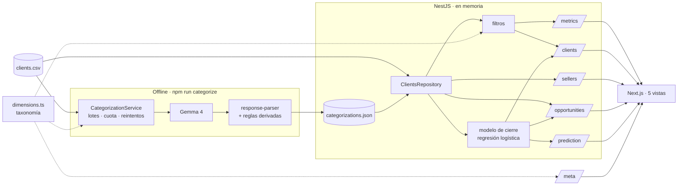

# Arquitectura y decisiones

Vambe Insights categoriza con un LLM (Gemma 4) las 10.000 transcripciones de reuniones de venta y muestra en un panel qué clientes cierran, qué piden y qué hacer con eso. El trabajo se divide en dos momentos: una **categorización offline** que llama al LLM una vez, y una **app de consulta** que nunca lo llama.



## Arquitectura

**Backend (NestJS).** Cada módulo sigue la misma forma: `*.controller.ts` define la ruta (sin lógica), `*.service.ts` coordina y la lógica vive en funciones puras con su test.

Las **capas base** son el código compartido que no conoce a ningún módulo de funcionalidad: los módulos las usan a ellas, nunca al revés. Lo que usa un solo módulo vive dentro de ese módulo (por ejemplo, las reglas derivadas en `categorization/` y las notas A–F en `prediction/`). Así la lógica común (por ejemplo, la tasa de cierre o el ajuste por cartera, que usan tres vistas) no se duplica y no hay dependencias circulares. Las flechas indican «importa de»:

```
capas base:  utils               (utilidades genéricas; no importa nada)
             domain    ─► utils  (vocabulario del negocio: clientes, dimensiones, volumen)
             analytics ─► domain, utils (cálculos compartidos por varias vistas)
             data      ─► domain, utils (acceso a los datos)

módulos:     metrics ─► filters ─► prediction
             clients ─► filters, prediction
             opportunities, meta ─► prediction
             sellers, health, categorization: solo capas base
```

```
backend/src
├── domain/          lo que usa todo el backend: dimensiones (dimensions.ts), tipos (categories.ts,
│                    client.ts) y rangos de volumen (volume.ts)
├── utils/           utilidades genéricas: texto, formato, colecciones, muestreo, límite de requests
├── analytics/       cálculos compartidos: tasas, desglose por dimensión, rasgos ganadores, desempeño por vendedor
├── data/            CSV + categorizaciones en memoria (ClientsRepository, CategorizationStore)
├── categorization/  pipeline del LLM: prompt/, llm/ (Gemma + cuota), parsing/, reglas derivadas, evaluation/
├── filters/         el segmento filtrado, compartido por la tabla y las métricas
├── prediction/      modelo de cierre y notas A–F (grades.ts)
├── metrics/ · sellers/ · opportunities/ · clients/ · meta/ · health/   un módulo por endpoint
└── cli/             npm run categorize y npm run evaluate
```

**Frontend (Next.js 15).** Las páginas son Server Components: leen los filtros de la URL, piden los datos al backend y los validan con Zod antes de pasarlos a los componentes. Solo los controles interactivos son componentes cliente.

```
frontend/src
├── app/             una carpeta por vista: General (/), vendedores, oportunidades, prediccion, clientes
├── lib/             todo lo que no es presentación, con tests:
│   ├── api/         cliente tipado, un esquema Zod por endpoint y tipos derivados
│   ├── filters/     filtros ↔ URL, chips de filtros activos y links
│   └── …            formato es-CL, etiquetas, KPIs, predicción, períodos
└── components/      una carpeta por vista + ui/ (componentes base)
```

## Decisiones clave

### 1. La taxonomía es la fuente única de verdad
`domain/dimensions.ts` define cada dimensión: valores permitidos, etiquetas y criterios. De ahí se generan el prompt, la validación de la respuesta del LLM, los filtros de la API (un valor inexistente responde 400) y `/api/meta`, del que el frontend toma filtros y etiquetas. Agregar un valor es editar un archivo; no hay listas duplicadas que se desincronicen.

### 2. Categorías cerradas con criterios explícitos por valor
El LLM elige entre valores predefinidos, así «Clínica dental» y «Consulta odontológica» caen ambas en `salud` y se pueden agregar. Cada valor tiene reglas observables con prioridad cuando varias aplican. Por ejemplo, el tamaño se decide primero por la cantidad de locales, después por la de empleados y después por cómo se describe el negocio, y sin pistas queda «No especificado» en vez de adivinarse. Los mismos criterios se usan para etiquetar los evals, así el modelo y quien etiqueta aplican la misma definición. *Descartado:* etiquetas libres (no se pueden comparar) y descripciones de una línea (el modelo las interpretaba distinto en cada corrida).

### 3. Reglas fijas en código, no en el LLM
La **complejidad técnica** (alta con 2+ integraciones, varios idiomas o datos sensibles; media con 1 integración o algún flujo transaccional; baja si solo informa) y el dolor **volumen alto** (más de 5.000 consultas al mes) se calculan en `categorization/derived-rules.ts` a partir de lo que el LLM extrajo. Pedírselas al modelo daba resultados inconsistentes: la complejidad pasó de 63% a 100% de acierto.

### 4. Validación defensiva de la respuesta del LLM
Gemma no tiene *JSON mode* en esta API, así que `response-parser.ts` extrae el JSON aunque venga con texto alrededor, normaliza tildes y mayúsculas, reemplaza valores inexistentes por «Otro» o un valor neutro, interpreta cifras como «1.500» y descarta solo los elementos inválidos, no el lote completo.

### 5. Pipeline de categorización barato y robusto
- **Lotes de 10 transcripciones** por request, emparejadas por un número `ref`: 10 veces menos llamadas.
- **`gemma-4-26b-a4b-it`** como modelo principal: solo activa ~4.000 millones de parámetros por palabra, así que es rápido, y la extracción no necesita más. El `31b` midió lo mismo (95% contra 96% por caso) y es más lento; queda como **respaldo** cuando el principal responde 503 (saturado), algo frecuente en el plan gratuito. Cada registro guarda qué modelo respondió.
- **Razonamiento mínimo** (latencia ~10 veces menor) y **temperatura baja** (0 para evaluar).
- **Control de cuota compartido** entre 5 workers: un semáforo genérico (`utils/rate-limiter.ts`) y, ante un 429, una pausa para todos (`rate-limited.provider.ts`).
- **Reanudable:** solo procesa reuniones sin categorizar y guarda cada lote con escritura atómica. Las que el modelo no devolvió se reintentan de a una.

### 6. Categorización offline: el despliegue solo consulta
El resultado se versiona en el repo (`backend/data/categorizations.json`) y el servidor desplegado solo lo lee. Así no hay API key expuesta en el hosting ni gasto de cuota desde la app, todos ven los mismos números que miden los evals y el backend cabe en el plan gratuito de Render. Por eso `render.yaml` no define `GEMINI_API_KEY`.

### 7. Datos en memoria, sin base de datos
Con 10.000 filas, filtrar y agregar en memoria toma milisegundos; una base de datos sumaría infraestructura sin beneficio a esta escala. El acceso a datos está aislado en `ClientsRepository` y `CategorizationStore`: pasar a Postgres es reimplementar esas dos clases. El store revisa cada 5 s si el archivo cambió, así el panel se actualiza mientras corre una categorización, sin reiniciar.

### 8. Filtros compartidos y en la URL
La tabla de clientes y las métricas usan el mismo DTO y la misma función `applyFilters`, así siempre muestran el mismo grupo. Los filtros combinan con **O** dentro de una dimensión (salud o retail) y con **Y** entre dimensiones (salud y referido). En el frontend viven en la URL: una vista filtrada se comparte, se guarda y funciona con «atrás».

### 9. Métricas que no engañan
- **Todo sale de los datos.** Hallazgos, cuadrantes, rasgos ganadores y sugerencias se calculan; no hay consejos escritos a mano.
- **Desempeño ajustado por cartera.** Cada vendedor se compara con lo que se esperaría según los rubros de sus leads (estandarización directa), así un vendedor con rubros difíciles no queda último por la asignación que le tocó.
- **Muestras chicas.** Un grupo necesita al menos 10 reuniones (o el 2% de las analizadas) para competir en un ranking; los más chicos se muestran atenuados al final, porque «3 de 3» no es un 100% confiable. Los valores comodín («Otro», «No especificado») no generan hallazgos.

### 10. Predicción con regresión logística propia
Estima la probabilidad de cierre a partir de lo que extrajo el LLM, el vendedor y la combinación vendedor × industria. Cada rasgo tiene un peso que sube o baja la probabilidad, y el modelo es **interpretable**: cada peso se explica como cuánto multiplica las chances de cierre (p. ej. «urgencia alta ×1,4»). Está implementado sin dependencias en `prediction/logistic-regression.ts`. Entrenar es buscar los pesos que minimizan el error de predicción más una penalización:

- **Regularización L2:** se penaliza la suma de los pesos al cuadrado. Como el costo crece rápido, un rasgo solo recibe un efecto fuerte si muchas reuniones lo respaldan; un rubro con 8 reuniones y 7 cierres queda cerca de «no cambia nada». Achica todos los pesos sin eliminar ninguno, a diferencia de L1, que deja algunos en 0. La fuerza de la penalización se elige en cada entrenamiento entre {3, 10, 30, 100} con validación cruzada de 5 partes.
- **Método de Newton:** para encontrar esos pesos usa la pendiente y la curvatura del error, así sabe cuánto avanzar en cada paso. Llega al óptimo exacto en ~10 pasos, contra los cientos del descenso de gradiente, y es el mismo método de R o statsmodels. Funciona porque la penalización L2 es suave.

En la validación cruzada cada cliente recibe la probabilidad de un modelo que no lo vio, así las métricas no están infladas. Se entrena al arrancar (~2–3 s) y de nuevo solo si cambian los datos. Las **notas A–F** usan cortes fijos (A ≥ 85%, luego tramos de 5 puntos, F < 65%) y no cuantiles, para que la proporción de clientes en cada nota diga algo. *Descartado:* librerías de ML (dependencia pesada para un modelo de ~80 variables) y guardar el modelo entrenado (habría que mantenerlo sincronizado con los datos y el código para ahorrar 2 s).

### 11. Contratos tipados en ambos lados
El backend valida la entrada (`class-validator`, 400 ante valores desconocidos), la configuración al arrancar (Zod) y la respuesta del LLM (parser), y declara el tipo de cada respuesta en `*.types.ts`. El frontend valida cada respuesta con un esquema Zod y deriva sus tipos de él, así un cambio incompatible falla al llegar y no como un `undefined` en un gráfico. *Descartado:* un paquete de tipos compartido, que complicaría desplegar backend y frontend por separado.

### 12. Evals para guiar el prompt
`npm run evaluate` compara la respuesta del LLM con 50 casos de referencia (`gold.json`, el *gold standard*). Los criterios se ajustaron mirando 24 casos y los otros 26 se etiquetaron después solo con los criterios escritos: son una **prueba independiente** que detecta reglas que solo sirven para los casos con que se escribieron. Los cambios de prompt se comparan a temperatura 0 y con 2–3 corridas, porque el modelo varía entre ejecuciones.

## Dimensiones

| Dimensión | Tipo | Para qué sirve |
| --- | --- | --- |
| Industria | simple | Qué rubros convierten más y menos |
| Tamaño | simple | Estrategia y pricing para pymes vs. cuentas grandes |
| Canal de adquisición | simple | Retorno de cada canal de marketing |
| Canal de consultas | simple | Qué canales debe cubrir el producto |
| Dolor principal | simple | El problema de fondo, para ajustar el pitch |
| Urgencia | simple | Prioridad de seguimiento del lead |
| Estacionalidad | simple | Si tiene temporadas o campañas con más consultas |
| Complejidad técnica | simple, calculada | Esfuerzo de implementación (decisión 3) |
| Casos de uso | lista | Qué funciones pide al chatbot |
| Integraciones | lista | Roadmap de conectores (CRM, ERP, agenda…) |
| Requisitos clave | lista | 24/7, multiidioma, derivación a humano, datos sensibles… |
| Objeciones | lista | Frenos explícitos (precio, comparando alternativas…) |
| Consultas/mes y en peak | número | Volumen normal y de temporada alta, para dimensionar el valor |
| Resumen | texto | Lectura rápida de la necesidad |

## Vistas

| Vista | Qué responde | Reglas clave |
| --- | --- | --- |
| **General** | Cifras del mes (vs. mes anterior y mismo mes del año pasado) o del histórico; lo más importante; qué clientes cierran más y qué piden; vendedores | Hallazgos: los 2 grupos que más suben y los 2 que más bajan la tasa, con al menos 3% de la muestra y 2 puntos de diferencia |
| **Vendedores** | Cómo le va a cada uno frente a lo esperado, su mejor y peor rubro, y una tabla vendedor × industria | Rubros con 8+ reuniones del vendedor; se destacan diferencias de 5+ puntos con el equipo |
| **Oportunidades** | Dónde poner el esfuerzo (mapa de segmentos), a quién volver a llamar, qué vendedor toma cada rubro, qué frena las ventas y qué construir una vez para muchos rubros | Mapa: volumen sobre o bajo la mediana × conversión a ±3 puntos del promedio. Leads: los 10 sin cerrar con mayor probabilidad, con sus razones y el vendedor que la subiría 1+ punto. Asignación: +5 puntos sobre el equipo. Frenos: rasgos 3+ puntos bajo el promedio, con sus rasgos ganadores. Soluciones: combinaciones de casos de uso presentes en 4+ industrias |
| **Predicción** | Notas A–F con su tasa de cierre real, cerrados vs. no cerrados por probabilidad y factores que más la mueven | Decisión 10 |
| **Clientes** | Búsqueda sin tildes, filtros por cualquier dimensión, orden, paginación y detalle con transcripción y categorización | Decisión 8 |

**Rasgos ganadores** (`analytics/winning-traits.ts`): dentro de un grupo, los rasgos con los que sus clientes cierran 5+ puntos más que el grupo, con al menos el 10% del grupo y 10 reuniones. Son asociaciones, no causas: indican dónde mirar.

## API

| Endpoint | Descripción |
| --- | --- |
| `GET /api/meta` | Taxonomía, opciones de filtro, vendedores, rango de fechas y cobertura de la categorización |
| `GET /api/metrics?…filtros&period` | Vista General del segmento filtrado. `period=YYYY-MM` compara ese mes (por defecto, el último); `period=historico`, solo totales |
| `GET /api/clients?…filtros&page&pageSize&sortBy&sortDir` | Listado paginado |
| `GET /api/clients/:id` | Detalle con la transcripción completa |
| `GET /api/sellers` | Desempeño por vendedor y tabla vendedor × industria |
| `GET /api/opportunities` | Mapa de segmentos, leads a recuperar, asignación, frenos y soluciones replicables |
| `GET /api/prediction` | Calidad del modelo, notas, distribución y factores |
| `GET /api/health` | Estado del servidor, para el hosting |

Filtros: `search`, `sellers`, `closed`, `categorized`, `from`, `to`, `volume`, `grade` y cada dimensión (`industry`, `leadSource`, …) como lista separada por comas.

## Precisión del LLM

**96% de las dimensiones correctas por caso**, en promedio de 2 corridas sobre los 50 casos de referencia; 29 casos salen perfectos en ambas.

| Dimensión | Ajuste (24) | Prueba (26) | Total | Prompt anterior (24) |
| --- | --- | --- | --- | --- |
| Industria | 100% | 100% | 100% | 96% |
| Canal de adquisición | 100% | 100% | 100% | 88% |
| Complejidad técnica (calculada) | 100% | 100% | 100% | 63% |
| Estacionalidad | 100% | 100% | 100% | 100% |
| Objeciones | 100% | 100% | 100% | 100% |
| Integraciones | 96% | 100% | 98% | 71% |
| Tamaño | 98% | 96% | 97% | 46% |
| Canal de consultas | 96% | 98% | 97% | 94% |
| Dolor principal | 94% | 96% | 95% | 88% |
| Requisitos clave | 94% | 94% | 94% | 77% |
| Urgencia | 83% | 100% | 92% | 94% |
| Casos de uso (solapamiento 90%) | 79% | 77% | 78% | 38% |
| Consultas/mes (±20%) | 100% | 92% | 96% | 100% |
| Consultas/mes en peak (±20%) | 100% | 100% | 100% | 100% |

Los casos de ajuste y de prueba dan resultados parejos, así que los criterios no quedaron hechos a la medida de los casos con que se escribieron. Los errores que quedan son reglas escritas que Gemma no siempre sigue: sube la urgencia cuando el volumen es grande y omite o agrega algún caso de uso suelto. Más ajustes al prompt arreglaban unos casos y rompían otros. Probar el `31b` como principal, una transcripción por request o el razonamiento activado no mejoró la precisión y multiplicó el tiempo.

*Limitaciones:* la muestra es chica (cada caso mueve 2–4 puntos) y las etiquetas no las puso el equipo comercial: un asistente de IA aplicó los criterios escritos y una persona revisó los primeros 24 casos y decidió los dudosos.

## Limitaciones y producción

- **Escala:** los datos en memoria y el JSON alcanzan para 10.000 reuniones. Con más volumen o escrituras concurrentes, Postgres.
- **Modelos mezclados:** cuando el principal está saturado responde el de respaldo, así que una parte de las categorizaciones viene del `31b`. En producción se usaría un plan pagado y un solo modelo.
- **Evals:** 50 casos son una muestra chica; lo ideal es que el equipo comercial agrande el gold.

**Categorización en producción (propuesta).** Hoy es una carga única; en producción las reuniones llegan a diario. Cambia la infraestructura, no la lógica: taxonomía, prompt, parser y reglas derivadas se reutilizan tal cual.

| Tema | Hoy | En producción |
| --- | --- | --- |
| Disparador | Comando manual | Cada reunión nueva (CRM, grabación o CSV subido en la app) crea un trabajo en una cola |
| Datos | CSV + JSON en memoria | Postgres, con versión del prompt, modelo y respuesta cruda por categorización |
| Workers | 5 en el mismo proceso | Proceso aparte que consume la cola (BullMQ o pg-boss), con control de cuota compartido |
| Fallos | Reintento y luego «fallida» | Reintentos con espera y cola de fallidos que se puede relanzar |
| Lotes | 10 fijos | Micro-lotes: lo que llegue en ~30 s, hasta 10 |
| Modelo | Gemma gratis con 503 frecuentes | Plan pagado con disponibilidad garantizada; el parser sigue validando |

Además: al cambiar el prompt, un trabajo en segundo plano recategoriza lo anterior; en CI, un cambio de prompt no se acepta si los evals bajan de un umbral; en producción se vigila la deriva (% de «Otro», respuestas no interpretables, fallidas); las transcripciones se envían al LLM con emails, teléfonos y nombres enmascarados; y el modelo de predicción se entrena en un trabajo aparte y se guarda con versión.
